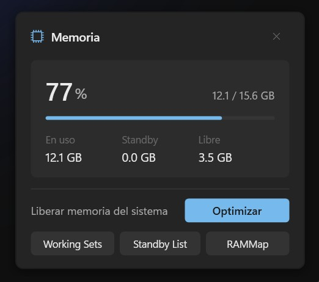

# RAMMapTray

A lightweight Windows system tray utility and companion for Microsoft Sysinternals RAMMap, featuring a Windows 11-style flyout and native memory optimization via the Windows NT API.



## Features

- **Live Tray Icon:** Real-time RAM load percentage rendered dynamically in the taskbar notification area.
- **Windows 11 Dark Flyout:** Clean flyout interface showing total, used, standby, and free physical memory.
- **Native Kernel Memory Purge:** Direct P/Invoke calls to `ntdll.dll` (`NtSetSystemInformation`) with elevated privileges to flush:
  - Standby List
  - Working Sets (with per-process working set trimming)
  - Modified Page List
- **Sysinternals RAMMap Integration:** Focuses existing RAMMap instances or launches `RAMMap64.exe` / `RAMMap.exe` if present.
- **UAC-free Autostart:** Windows Task Scheduler script (`schtasks`) to start elevated on login without UAC prompts.

## Building

Requires Windows 10 (1809+) or Windows 11 (x64) and the .NET SDK (8.0, 9.0, or 10.0 preview).

```bash
cd src
dotnet build -c Release
```

To publish as a self-contained single-file executable:

```bash
dotnet publish -c Release -r win-x64 --self-contained -p:PublishSingleFile=true
```

## Setup

1. Build or download `RAMMapTray.exe`.
2. *(Optional)* Place `RAMMap64.exe` (from [Sysinternals](https://learn.microsoft.com/sysinternals/downloads/rammap)) next to the executable or in your system `PATH` if you want the "Open RAMMap" button to launch the official tool.
3. Run `scripts/ConfigStartWindows.bat` as Administrator to enable auto-start on logon.
